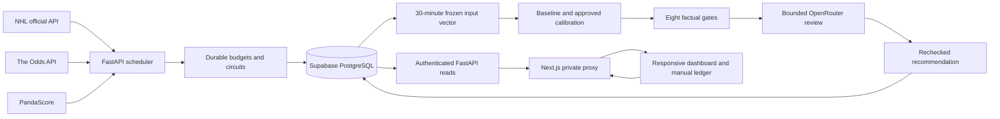

# Architecture and operational contracts

## Data flow

The two services are independently deployable containers. The database is the durable authority. There is no desktop dependency, browser-triggered ingestion, raw-statistic LLM loop, or automatic wager execution.

## Tables

`fixtures` stores state, source identifiers, probability, required target price, edge, suggested CAD stake, gates, bounded metrics, and the latest risk report. `market_odds` stores normalized per-outcome prices with exact market/selection/line identity. `personal_bets` stores actual ticket prices/stakes, frozen unit size, settlement state, and profit. `account` holds the initial CAD bankroll.

`source_evidence` records provider timestamps separately from observation timestamps. `frozen_snapshots` stores the 15-field vector, original bounded source payloads/provenance, frozen baseline factors, baseline and calibrated prediction, model version, outcome, and Brier error. `model_validation` stores sport-specific calibration parameters and holdout results.

`runtime_limits` stores per-provider Pacific-day/month reservations, USD reservations, fixture lifetime caps, the emergency pause, and outage latches. `provider_calls` stores durable paid request identities and conservative charges; `provider_state` caches non-secret quotas and account observations. `evaluation_cycles` stores per-cycle attempt counts and bounded reusable assessment results. `job_leases` prevents duplicate job/evaluation dispatch during restarts or overlapping processes. `audit_log` stores wager actions, provider pause/resume, evidence verification, and archived snapshots when official start times change.

All application timestamps use timezone-aware `America/Vancouver`. PostgreSQL `timestamptz` stores instants; sessions and application output use Vancouver time. The pinned IANA `tzdata` wheel handles Vancouver's 2026 permanent Pacific time rule and older historical DST dates. The frontend formats the server's Vancouver wall-clock timestamp instead of trusting an outdated browser timezone database.

## Schedule

| Job | Frequency | Limit and recovery |
|---|---|---|
| NHL history and fatigue collection | Daily 04:00 Vancouver | One instance; bounded team count; no target-date games |
| NHL schedule/standings + available personnel details | Hourly, plus pre-anchor preparation | Histories cached four hours with original timestamps; at most six imminent game details per cycle |
| PandaScore upcoming/recent matches and rosters | Disabled in NHL phase | Later requires appropriate license, verified contracts, and explicit activation |
| Sportsbook prices | Local wake every five minutes; paid batch at most once per two-hour period | NHL only; 48-hour horizon; skip absent official fixtures; three exact market types |
| Frozen snapshot | Official start minus 30 minutes | Date trigger; all source observations must precede cutoff; max five seconds processing delay |
| Gate refresh | Every minute | Database only; max 60 imminent fixtures; no background paid loop |
| NHL/esports final outcomes | Every four hours | Bounded unresolved fixtures; final scores never settle tickets automatically |
| Database pulse | Every 48 hours | `SELECT 1`; no uptime guarantee for a free database |
| Raw source and quote retention | Daily | Seven days; frozen source provenance and ticket/audit history survive |

Scheduler jobs coalesce missed interval triggers and allow one concurrent run each. Persistent leases last at least as long as each job's deadline. Exact anchors are never backfilled with post-anchor information. A reschedule archives the old snapshot in the audit log, clears the active snapshot, revokes recommendations, and schedules a new anchor. Startup recovery is bounded and does not replay every missed paid request.

## Hard request boundaries

| Boundary | Default |
|---|---:|
| Odds credits per Pacific day | 120 |
| Odds credits per Pacific month | 500 |
| PandaScore HTTP attempts per day | 0 |
| OpenRouter HTTP attempts per day | 12 |
| OpenRouter USD per day / month | 0 / 0 (paid AI disabled) |
| OpenRouter USD reservation per review | 0.01 |
| NHL HTTP attempts per day | 300 |
| Attempts per HTTP cycle | Paid: 1; free: up to 3 for bounded redirects or short 429 cooldowns |
| LLM attempts per fixture lifetime and evaluation cycle | 3, persisted before transmission |
| OpenRouter total deadline | 15 seconds, including key preflight and body reading |
| Other providers' total cycle deadline | 45 seconds |
| Provider response | 1,000,000 bytes by default, streamed with bounded chunks |
| Backend/proxy mutation body | 16,384 bytes |
| Dashboard login body | 1,024 bytes |
| LLM serialized statistics summary | 3,500 bytes |
| LLM completion | 600 tokens |
| Free provider circuit cooldown | 15 minutes |
| Paid provider failure recovery | Explicit operator resume; identities and budgets remain consumed |

Budget reservations commit before a network attempt and are not refunded after errors or crashes. Odds attempts reserve three credits for three markets and fewer than ten explicitly selected bookmakers. Paid requests never retry automatically, including GETs and 429s. Free retries consume request reservations. Provider quota exhaustion closes paid ingestion. Free Retry-After values over four seconds stop the request cycle and open a cooldown. Other application/account activity is outside these per-application budgets; provider account spending limits remain necessary for an account-wide currency cap. See [API budgets](API_BUDGETS.md) for verified prices, usage estimates, source limitations, and account checks.

## Probability, market, and personnel contracts

The user-specified NHL and CS2 weights live in `model_config.py`. Each factor must be a complete, source-backed normalized home-minus-away difference in [-1,1]. A weighted logit is a deterministic baseline, not a calibrated win probability. The supplied 40/35/15/10 and 40/30/20/10 impacts sum to one. Other sports have no invented baseline.

The fixed vector order is:

1. Home points percentage
2. Away points percentage
3. Home minus away points percentage
4. Home season games
5. Away season games
6. Home recent win rate
7. Away recent win rate
8. Home minus away recent win rate
9. Home recent sample size
10. Away recent sample size
11. Home days rest
12. Away days rest
13. Home minus away days rest
14. Home back-to-back flag
15. Away back-to-back flag

Season samples need five games; recent samples need three to ten. Rest is the number of complete off-days between game dates; zero means a back-to-back. NHL season-schedule responses lack verified end timestamps, so the adapter conservatively uses a next-day boundary and excludes target-date matches; that can omit a recent game rather than leak an overlapping one. Esports history is restricted to the preceding three calendar months and excludes same-date/overlapping matches. Full season statistics are never inferred from a truncated esports history page.

Source age at the logical anchor is at most two hours for schedule, three hours for standings, and 26 hours for team history. Source time and observed time must both precede or equal the anchor. Model-factor observations also precede the anchor and must be at most 30 minutes old. A late anchor remains HOLD.

Recommendation probabilities apply only to complete binary **h2h** markets. Three-way moneyline markets are rejected. Spread/totals quotes are retained for comparison and manual logging, with exact numerical targets; they do not borrow a moneyline probability. A quote with decimal odds <=1.0001 is rejected. `q=1/decimal_odds` is quantized to four decimals using `ROUND_HALF_UP`. Home/away provider joins require exact normalized team names, sport, and a start within five minutes; ambiguous joins are rejected.

Missing starting personnel causes HOLD. Missing execution source otherwise causes WATCH. Missing model validation causes HOLD; insufficient edge causes PASS. The eight factual gates are price, personnel, form, maps/veto, other markets, opposing case, overlap/exposure, and probability. NHL maps/veto is explicitly not applicable and passes as such. A positive AI statement cannot open a missing factual gate; it can only veto or explain existing evidence. Data/exposure changes mark the fixture DIRTY, zero the suggested stake, and require re-evaluation. Data revision is rechecked after the paid review returns.

Kelly uses a 0.25 multiplier, a 1.5% per-ticket bankroll hard cap, a 6% total open-exposure cap, and a duplicate pending-fixture block. Cent rounding never increases a hard cap. The default probability edge threshold is three percentage points. These extra conservative boundaries are configurable in `model_config.py`.

## Browser behavior and settlement

Dashboard reads are at most once per minute while active; they only query the backend database. Hidden tabs abort active reads and stop polling. Fifteen minutes of inactivity stops polling and rendering until user activity resumes. Source age—not time of the browser fetch—determines the five-minute stale badge and suppresses the recommendation shortlist.

The WebGL asset uses original point-cloud shaders with cyan, blue, and violet particles that morph between basketball, football, baseball, and puck shapes. Pointer proximity displaces particles; a tap disperses them before they reform. Rendering is capped at 30 fps and stops offscreen, in hidden tabs, and during inactivity. Reduced-motion displays a static shape; unavailable WebGL has a CSS fallback. Static PWA identity assets may be cached; session HTML, odds, and ledger responses are never cached.

Watchlist sliders set minimum confidence, probability edge, and verification coverage from 0–100%. Coverage counts the eight existing gates, including explicit not-applicable passes. A positive confidence or edge minimum excludes missing metrics; zero includes them. Filters compose with sport and search, persist locally, and affect the displayed watchlist and shortlist only. Model parameters, approval, recommendation gates, and staking are unchanged.

The performance card reads all recorded wagers, independent of ledger pagination and watchlist filtering. Win rate is WIN/(WIN+LOSS); ROI includes WIN/LOSS/PUSH turnover and excludes VOID/PENDING. No settled results means unknown win rate and ROI, displayed as an em dash. The cumulative CAD curve groups latest settlement updates by Vancouver date and preserves corrections; it is bounded to 180 points while retaining cumulative totals. Model accuracy and Brier score use resolved directional frozen predictions, with a separate sample count. Recorded wager ROI is not labeled model ROI.

Wagers use a request UUID for idempotency and an account row lock to serialize balance changes. Prices are stored as Decimal with eight fractional digits, stakes and unit size as CAD cents. WIN profit is stake times (decimal odds minus one), LOSS is minus stake, and PUSH/VOID/PENDING profit is zero. ROI excludes VOID and PENDING stakes; PUSH remains in settled turnover. Changing settlement recomputes the profit from original ticket values and audits the before/after states. API Decimal values serialize as strings to preserve financial precision.

## Outstanding production verification

The October 13, 2026 recovery verified both existing Render services, migration 0001, authenticated dashboard and ledger reads, readiness, and 25 real NHL fixtures. See DEPLOYMENT_RECOVERY.md for the database pooler, CA trust, and bounded NHL redirect changes. Advanced metric, personnel, and esports odds adapters remain closed until supported contracts are verified. Paid ingestion is not forced by frontend reads or design testing.

## Requested delivery files

`backend/main.py` is the complete API entry point and uses the implemented `backend/app/` analytics modules. `backend/requirements.txt` is fully pinned. `frontend/package.json` is pinned to the installed frontend dependencies and declares the build/run/test commands. The database adapter accepts the configured direct Supabase host or an official Session Pooler host with this project's qualified username on port 5432. It rejects transaction pooling and normalizes password encoding without logging credentials. The existing `.env` is unchanged.
